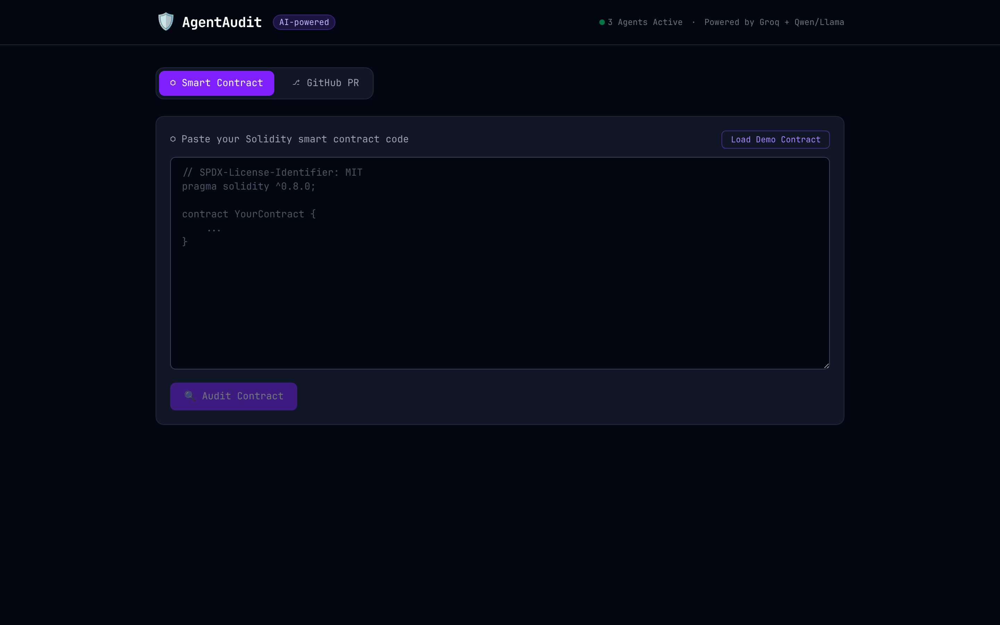
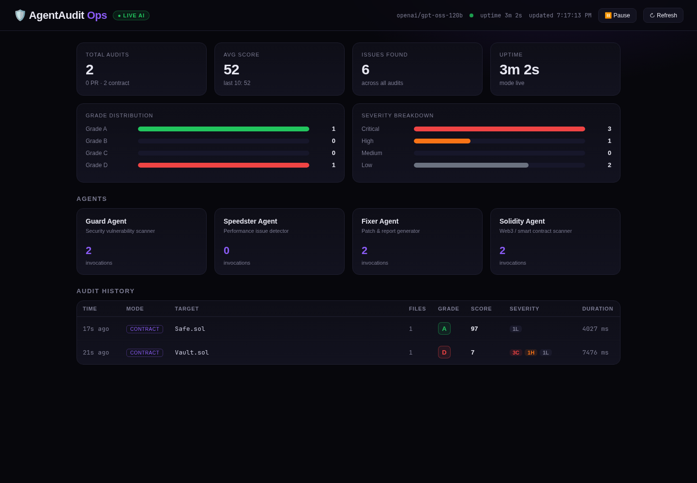

# AgentAudit

> **Three AI agents. One click. Instant smart contract & code security audit.**

AgentAudit is an autonomous multi-agent AI security scanner for **Solidity smart contracts** and **GitHub Pull Requests**. Instead of a single generic AI prompt, it runs three specialized agents in parallel — each with a distinct role — to produce a comprehensive, visual audit report with severity ratings and one-click code fixes.

## Live Demo

> **App:** [agentaudit-gamma.vercel.app](https://agentaudit-gamma.vercel.app) · **API:** [agentaudit-backend-tutf.onrender.com](https://agentaudit-backend-tutf.onrender.com/docs)

[](https://agentaudit-gamma.vercel.app)

*Frontend on Vercel · FastAPI backend on Render (free tier — first request may take ~30s to wake).*

---

## Demo


*Real run: paste a vulnerable Solidity contract → 3 agents run in parallel → Grade D report with severity-sorted findings and one-click fixes.*

---

## How It Works

```
 Smart Contract / GitHub PR Diff
            │
  ┌─────────┼──────────┐
  ▼         ▼          ▼
🛡️ Guard  ⚡ Speedster  🛠️ Fixer
Agent      Agent       Agent
  │         │          │
  └─────────┼──────────┘
            ▼
  📊 Visual Audit Report
     Grade A–D · Score/100
     Severity-sorted Issues
     Vulnerable + Fixed Code
```

| Agent | Role |
|---|---|
| 🛡️ **Guard** | Detects security vulnerabilities (reentrancy, hardcoded secrets, SQL injection, access control gaps) |
| ⚡ **Speedster** | Finds performance issues (N+1 queries, nested loops, blocking I/O, memory leaks) |
| 🛠️ **Fixer** | Generates drop-in corrected code for every flagged issue |

For Solidity files, a fourth **Solidity Agent** specifically hunts:
- Reentrancy attacks
- Missing `onlyOwner` on state-changing functions
- `tx.origin` authentication bypass
- `selfdestruct` / `delegatecall` misuse
- Floating pragma versions

---

## Quick Start

### Prerequisites
- Python 3.11+
- Node.js 18+
- Free [Groq API key](https://console.groq.com) (takes 30 seconds)

### Backend

```bash
cd backend
python -m venv venv && source venv/bin/activate
pip install -r requirements.txt
cp ../.env.example ../.env   # then add your Groq key
uvicorn main:app --reload --port 8000
```

API docs available at `http://localhost:8000/docs`

### Frontend

```bash
cd frontend
npm install
npm run dev      # opens http://localhost:5173
```

### Environment Variables

```env
GROQ_API_KEY=gsk_...          # required for live AI analysis
GITHUB_TOKEN=ghp_...           # optional — increases GitHub rate limit
```

> **No API key?** The app runs with rule-based mock agents — full pipeline demo works without Groq.

---

## API Reference

| Endpoint | Method | Description |
|---|---|---|
| `/health` | GET | Health check + mode (live/mock) |
| `/audit` | POST | Audit a GitHub PR by URL |
| `/audit/contract` | POST | Audit raw Solidity contract code |
| `/ops` | GET | Ops / monitoring dashboard (served by the backend) |
| `/ops/stats` | GET | Aggregate metrics (audits, avg score, grade + severity totals) |
| `/ops/agents` | GET | Agent roster, model, and invocation counts |
| `/ops/history` | GET | Recent audit records (`?limit=50`) |

**Example — audit a contract:**
```bash
curl -X POST http://localhost:8000/audit/contract \
  -H "Content-Type: application/json" \
  -d '{"code": "pragma solidity ^0.6.0;\ncontract Vault { ... }", "filename": "Vault.sol"}'
```

---

## Ops / Monitoring Dashboard

The backend ships its own live operations dashboard at **http://localhost:8000/ops** — no separate build or deploy needed. It auto-refreshes every 3 seconds and shows:

- **Live/mock mode**, active model, and process uptime
- **Aggregate metrics** — total audits, average score, issues found
- **Grade distribution** (A–D) and **severity breakdown** (critical → low)
- **Agent roster** with per-agent invocation counts
- **Audit history** — timestamp, mode, target, grade, score, severity, and duration



---

## Tech Stack

| Layer | Technology |
|---|---|
| Backend | Python · FastAPI · asyncio |
| AI Agents | Groq API · GPT-OSS 120B · Qwen 3.8 27B |
| GitHub Integration | GitHub REST API v3 |
| Frontend | React 18 · TypeScript · Vite · Tailwind CSS v4 |
| Deployment | Vercel (frontend) · Render (backend) |

---

## Project Structure

```
agentaudit/
├── backend/
│   ├── agents/
│   │   ├── guard.py        # Security vulnerability scanner
│   │   ├── speedster.py    # Performance issue detector
│   │   ├── fixer.py        # Patch generator
│   │   └── solidity.py     # Solidity / Web3 vulnerability scanner
│   ├── github.py           # PR diff fetcher
│   ├── models.py           # Pydantic data models
│   ├── store.py            # In-memory metrics + audit history
│   ├── static/
│   │   └── ops.html        # Ops / monitoring dashboard UI
│   ├── main.py             # FastAPI app + endpoints
│   └── requirements.txt
├── frontend/
│   └── src/
│       ├── components/
│       │   ├── Header.tsx
│       │   ├── ModeToggle.tsx
│       │   ├── PRInput.tsx
│       │   ├── ContractInput.tsx
│       │   ├── AuditDashboard.tsx
│       │   └── LoadingSpinner.tsx
│       ├── App.tsx
│       ├── types.ts
│       └── samples.ts
├── cli/
│   └── audit.py            # Terminal CLI tool
└── .env.example
```
